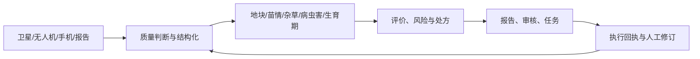
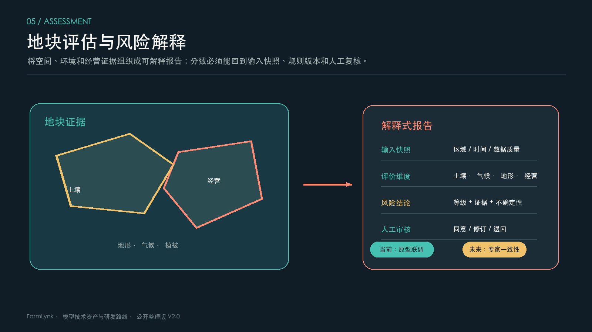
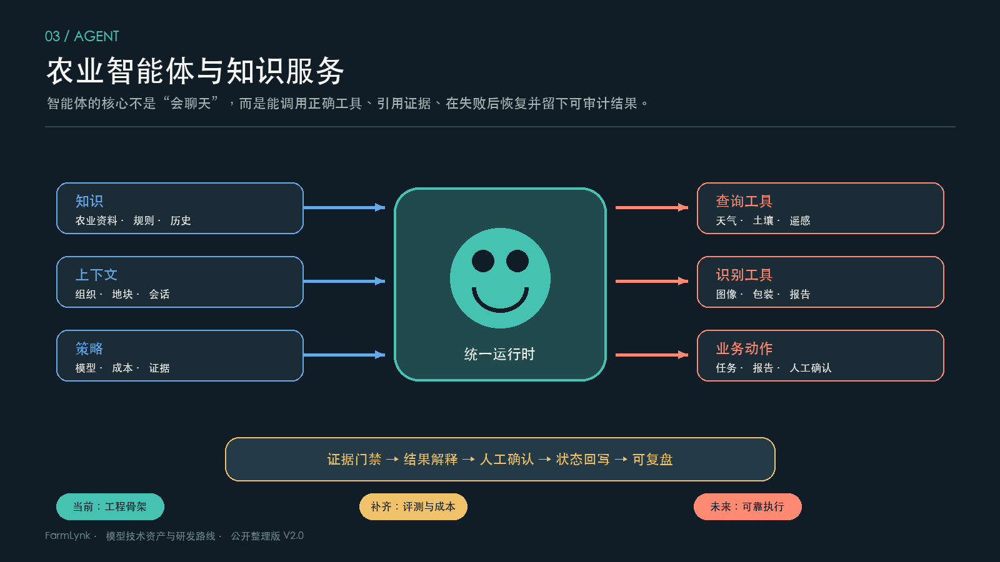
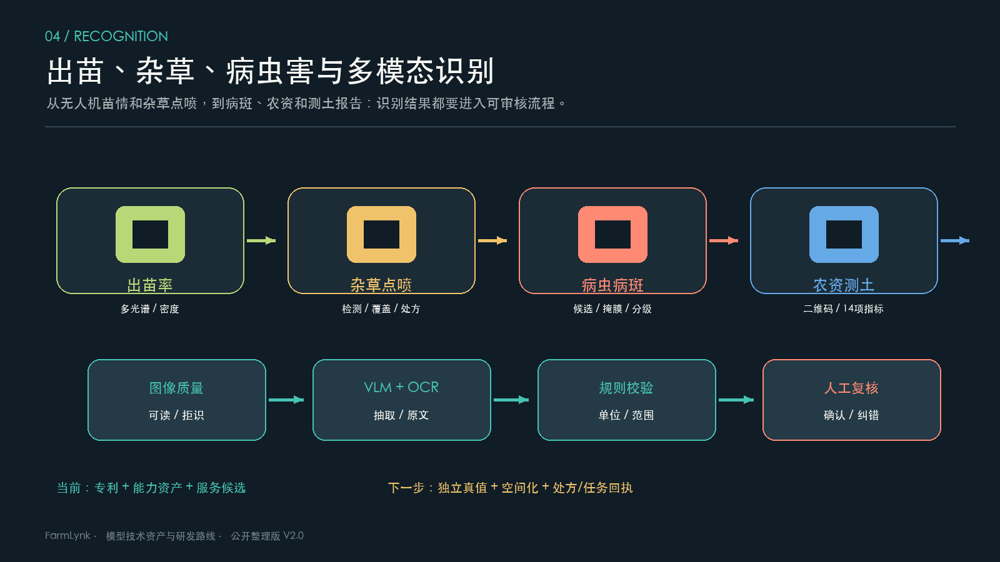

# 技术资产与研发路线 V2.0

公开整理版 · 2026-10-16

---

## 负责人汇报：过去成果与未来路线

## 1. 结论

过去的研发已经形成一条可复用的农业技术链：遥感影像进入质量判断和地块空间化，视觉模型处理出苗、杂草、病虫害、病斑和生育期，识别结果再进入地块评价、变量处方、无人机任务和农业智能体。当前最明确的技术成果是 Sentinel-2 分区处方、农资/测土报告识别、无人机苗情方向、地块边界分割方向和四类平台软件；最明确的知识产权是 7 项专利事项和 4 项软著。

关键判断是：能力已经不少，缺的是每项能力统一的证据和验收。报告因此把“已经有流程或产品承载”“有研究或专利依据”“已经现场验收”分开写。

## 2. 已形成的产品和模型

| 资产 | 已形成的结果 | 当前阶段 | 下一步验收 |
| --- | --- | --- | --- |
| Sentinel-2 NDVI 分区与施肥处方 | RGB/NDVI、K-means 五级分区、Shapefile 和 ISOXML 输出，默认施肥量按 30/60/90/120/150 kg/亩分档 | 产品化链路 | 真实地块回执、对照区效果、跨区稳定性 |
| 遥感云/云影质量与恢复 | 质量分层、可用性判断、恢复候选和时序消费边界 | 已有工程能力，专利已授权 | 清晰锚点误差、拒绝率和下游影响 |
| 地块边界实例分割 | 地块实例、边界、面积和空间底座方向 | 专利已授权，闭环待验 | 区域盲测、边界/面积误差、人工修边成本 |
| 无人机出苗率/密度识别 | 多光谱影像测算苗情，已有对应授权专利 | 专利已授权，产品验证待补 | 独立测试集、密度误差和苗情热力图 |
| 无人机样方框识别/矢量化 | 识别样方框并生成可统计区域 | 授权通知，证书待核 | 登记状态、定位误差、实际样方统计 |
| 无人机杂草识别与点喷处方 | 杂草位置/覆盖/阶段识别，以及影像到地理处方的链路设计 | 能力资产和课题规划 | 正射定位、漏误检、审核与设备回执 |
| 病虫害/病斑识别 | 病虫害、病斑分割和严重度方向 | 能力资产，智能体课题规划 | 专家分级真值、IoU、Macro-F1、MAE |
| 生育期识别 | 视觉和专家知识约束的阶段识别方向 | 专利申请公布准备 | 固定问图、相邻阶段错误、跨区泛化 |
| 农资与测土报告识别 | 农药二维码、肥料、助剂、测土报告四类流程，支持字段校验 | 服务化候选 | 字段真值、正确留空、批量稳定 |
| 地块评价与风险评分 | 多源证据、评分、风险项和报告 | 原型/软件承载 | 专家一致性、评分版本、真实回执 |
| 农业智能体与知识服务 | 检索、工具调用、识别和报告串联 | 工程骨架 | 固定问集、证据召回、工具成功率 |

## 3. 关键成果回顾

1. **从影像到处方**：已经具备 Sentinel-2 下载、RGB/NDVI 计算、五级分区、空间文件和农机处方输出的产品链路，这是当前最接近可演示产品的技术成果。
2. **从无人机影像到苗情**：出苗率/出苗密度测算已有授权专利；样方框识别与矢量化进入授权通知阶段，为试验调查和真值采集提供空间化能力。
3. **从无人机影像到点喷**：参赛资料已经明确杂草检测、覆盖度、阶段识别和点喷处方路径，但“处方生成”与“设备自动执行”必须分开验收，不能把方案链路写成现场效果。
4. **从图片到结构化农资数据**：农药二维码、肥料包装、助剂包装和测土报告都已有处理流程，下一阶段重点是字段级准确率和正确留空。
5. **从研究到产品候选**：FieldBCQ 对应地块边界分割方向，Wheat-KGCA 对应知识约束的生育期视觉识别方向；两者需要完成许可、复现和目标区域盲测后再进入产品试点。
6. **软件和知识产权**：Web、移动端、生产评估/农信贷、试验示范四项软件著作权已登记；专利台账已把专利状态与 MODEL-01～MODEL-15 对应起来。

## 4. 未来技术路线

### 第一阶段：补齐资产证据

给每个模型建立输入、输出、样本、指标、错误样例、版本和证据等级。优先补无人机出苗率、杂草点喷、病斑严重度、地块分割和遥感质量的独立测试集。

### 第二阶段：形成可审核的产品闭环

先把识别结果变成“可审核处方”，再连接设备任务。处方必须经过坐标、面积、剂量、药械和安全约束检查，并保留审核、下发、执行和失败回执。

### 第三阶段：做区域和现场验证

按区域、季节、设备和作业人员留出测试，报告空间误差、业务收益和失败边界。对于出苗、杂草、病斑等模型，必须同时报告识别指标和地块/任务层面的影响。

### 第四阶段：形成持续运营能力

建立模型版本、数据漂移、人工修订、回滚、专利权属和软件版本联动台账。达到 P3 以前只写“受控试点”，达到现场验收后才写“产品化”。

---

## 技术与产品总览

本页按可交付的技术资产组织内容，不按文件或代码位置组织。每项资产都有明确输入、输出、当前阶段和后续动作。

## 1. 资产分组

| 分组 | 包含资产 | 已有结果 | 当前瓶颈 |
| --- | --- | --- | --- |
| 遥感和空间底座 | Sentinel-2 处理、云影质量、NDVI 修复、地块分割 | 影像质量、时序、地块和处方的空间输入 | 清晰锚点、区域泛化、端到端验收 |
| 无人机识别和作业 | 出苗率/密度、样方矢量化、杂草识别、点喷处方 | 已有专利和参赛资料能力描述 | 正射定位、误差面积、设备回执 |
| 视觉和多模态识别 | 病虫害、病斑、生育期、农资、测土报告 | 四类农资识别流程，病虫草害和生育期方向 | 专家真值、正确留空、批量评测 |
| 评估和决策 | 地块评分、风险解释、变量播种/施肥处方 | 评估与处方产品承载 | 评分稳定、剂量守恒、真实反馈 |
| 智能体和知识 | 知识检索、工具调用、识别和报告 | 工程骨架和场景原型 | 固定问集、证据、工具成功率 |
| 研究转化 | FieldBCQ、Wheat-KGCA | 研究路线和历史结果 | 许可、权重、独立复现、盲测 |

## 2. 产品链路

## 3. 阶段口径

| 阶段 | 本版含义 |
| --- | --- |
| 研究规划 | 已有课题问题和验收指标，尚无完成结果 |
| 能力资产 | 有流程、专利、历史材料或服务骨架，但现场证据未齐 |
| 受控试点 | 有固定输入、版本、人工复核和独立评测 |
| 产品化 | 有现场验收、回执、监控、漂移处理和回滚 |

逐项清单见 [技术资产组合](03-asset-portfolio.md)，法律状态见 [知识产权台账](10-intellectual-property.md)。

---

## 模型与产品资产清单

清单对应 `data/model-inventory.json`，每一项都回答“做什么、做到哪、依据是什么、下一步验证什么”。当前不展开其他负责人维护的作物模型。

## 1. 逐项清单

| 编号 | 模型/产品 | 输入 → 输出 | 当前阶段 | 下一步 |
| --- | --- | --- | --- | --- |
| MODEL-01 | Sentinel-2 NDVI 分区与变量施肥处方 | 影像/地块 → 五级分区、Shapefile、ISOXML | 已有产品化链路 | 回执、对照区和跨区稳定 |
| MODEL-02 | 光学遥感云与云影去除/恢复 | 影像/质量 → 分层影像与可用时序 | 专利授权，工程完善 | 清晰锚点误差与下游影响 |
| MODEL-03 | 地块级 NDVI 多候选在线修复 | NDVI 序列 → 修复曲线和不确定性 | 专利申请公布准备 | 日期留出和观测/估算分离 |
| MODEL-04 | 农田地块边界实例分割 | 遥感/无人机 → 地块边界、面积 | 专利授权，闭环待核 | 区域盲测和人工修边 |
| MODEL-05 | 无人机小麦出苗率/密度识别 | 多光谱 → 出苗率/密度 | 专利授权，产品验证待补 | 独立测试集和误差热力图 |
| MODEL-06 | 无人机样方框识别与矢量化 | 无人机影像 → 样方矢量 | 授权通知，证书待核 | 登记状态和定位误差 |
| MODEL-07 | 无人机杂草识别、覆盖度和阶段 | 正射/单幅 → 杂草位置与覆盖 | 能力资产，指标待补 | 标注、定位和地块汇总 |
| MODEL-08 | 无人机杂草点喷处方 | 影像/识别/药械 → 点喷处方 | 方案链路，自动执行未证实 | 审核、下发和设备回执 |
| MODEL-09 | 病虫害与病斑识别 | 手机/近场/无人机 → 候选、掩膜、等级 | 能力资产和课题规划 | 专家真值、IoU、F1、MAE |
| MODEL-10 | 专家知识约束生育期识别 | 图像/时序/知识 → 阶段和证据 | 专利申请公布准备 | 固定问图和跨区验证 |
| MODEL-11 | 农资包装、二维码与测土报告识别 | 图片/报告 → 结构化字段 | 服务化候选 | 字段准确率和正确留空 |
| MODEL-12 | 地块综合评价与风险评分 | 多源地块信息 → 分数、风险、报告 | 原型和软件承载 | 专家一致性和真实回执 |
| MODEL-13 | 农业知识与智能体服务 | 生产上下文 → 检索、推荐、工具结果 | 工程骨架 | 固定问集和证据门禁 |
| MODEL-14 | 收获实时测产与产量地图 | 传感/称重/定位 → 产量图 | 研究课题规划 | 标定和称重真值 |
| MODEL-15 | 变量作业处方与农机作业图 | 分区/参数/设备 → 处方和回执 | 已有导出，回执待补 | 守恒校验和设备适配 |

## 2. 优先级

**优先转化**：MODEL-01、02、05、07、08、09、11、12、13、15。它们已经有产品链路、专利或参赛资料能力描述，适合先做固定场景验收。

**优先补证据**：MODEL-03、04、06、10。它们已有专利或研究依据，但需要权利要求映射、独立测试集和实际任务验证。

**按课题推进**：MODEL-14 以及研究院课题 01–04、07–19。课题状态不等于模型完成状态。

---

## 产品集成与现场闭环

## 1. 已有产品链路

### 遥感分区与施肥处方

产品接收 Sentinel-2 影像和地块范围，完成 RGB/NDVI 计算、K-means 自适应五级分区，输出分区统计、Shapefile 和 ISOXML 处方。示例处方按 30/60/90/120/150 kg/亩提供档位。当前可以说明“处方链路已形成”，还不能说明所有地块都取得了增产或节肥效果。

### 农资与测土报告识别

图片先经过可读性判断，再做二维码读取、OCR/VLM 抽取、字段和单位校验；结果进入结构化字段或人工复核。农药二维码、肥料包装、助剂包装和测土报告是四条独立流程，不能用一个总准确率替代。

### 地块评估与风险报告

地块位置、遥感、土壤、气象和经营信息组成输入快照，输出评价分数、风险项、证据和报告。评分版本和输入快照必须一起保存，否则无法复核同一地块为什么得到不同结论。

### 无人机识别到点喷

目标链路是“无人机影像 → 正射/地理参考 → 杂草检测、覆盖度和阶段识别 → 地理矢量化 → 点喷或分区处方 → 人工审核 → 设备任务 → 执行回执”。参赛资料已明确技术路线，但自动飞行或自动喷施的现场证据尚未在公开材料中形成，因此当前状态写成“方案链路”。

## 2. 统一集成要求

| 关口 | 必须记录 |
| --- | --- |
| 输入 | 数据来源、时间、空间范围、质量和授权 |
| 模型 | 版本、适用条件、拒绝条件、输出字段 |
| 人工 | 复核人、修改项、确认时间和退回原因 |
| 处方 | 面积、单位、剂量、坐标、设备能力和安全限制 |
| 执行 | 下发、下载、开始、完成、失败和现场回执 |
| 反馈 | 误检、漏检、现场修订和下一版本改进 |

## 3. 产品化门槛

一个能力只有同时具备固定输入、输出契约、错误样例、人工复核、版本号、独立指标和回滚方式，才能进入受控试点；要写成已产品化，还需要现场验收和持续监控。

---

## 遥感质量、时序与地块洞察

## 1. 已形成的技术结果

- Sentinel-2 影像可以被处理为 RGB、NDVI 和地块统计结果。
- NDVI 可以用 K-means 自适应划分为五级，作为长势分区和变量施肥处方的基础。
- 结果可以输出 Shapefile 和 ISOXML，进入空间查看或农机作业链路。
- 云和云影处理已有专利和工程质量分层方向；质量不足的日期需要降级或拒绝。
- 地块级 NDVI 多候选在线修复已提交专利申请，适配时序曲线课题，但公布、实审和产品验收尚未完成。

## 2. 当前状态

遥感方向处于“已有产品链路 + 质量协议完善 + 跨区验证待补”。已形成流程和输出格式，不代表恢复后的曲线在每个区域、季节和天气条件下都可靠。原生清晰观测、恢复估算、质量不足降级和拒绝结果必须分开标注。

## 3. 评测表

| 层面 | 指标 | 用途 |
| --- | --- | --- |
| 质量 | 云覆盖、有效像元率、清晰覆盖率 | 判定是否可消费 |
| 数值 | 光谱误差、NDVI 误差、偏差 | 判断恢复是否改变趋势 |
| 时序 | 日期留出误差、曲线稳定性、阶段偏差 | 判断能否支撑比较 |
| 空间 | 地块内一致性、边界外溢、分区稳定性 | 判断能否支撑地块决策 |
| 业务 | 处方误差、回执一致性、对照区效果 | 判断能否进入现场 |

## 4. 下一步

先建立跨区域清晰锚点和日期留出集，再把遥感质量分别接入地图、统计、评估和处方四种消费场景。所有恢复结果返回来源、质量等级和不确定性，不能把估算值伪装成观测值。

---

## 地块评估、风险解释与报告

## 1. 业务目标

地块评估把土壤、气候、地形、植被、经营和历史事件放到同一个地块时间快照中，输出可解释的等级、风险和下一步动作。它服务的是农业经营、金融评估和生产管理，核心交付不是一个孤立分数，而是“输入是什么、为什么这样判断、哪些证据不足、谁确认过”的完整报告。

## 2. 当前形成的链路

1. **申请与范围**：明确地块、时间窗、服务场景、用途和授权边界。
2. **输入快照**：锁定地块几何、数据日期、质量状态、缺失字段和来源。
3. **指标计算**：按统一字典计算土壤、气候、地形、植被、经营和暴露指标。
4. **分层评分**：保留维度分数、权重、规则版本和不确定性，不只返回总分。
5. **解释与复核**：把主要驱动因素、风险触发条件、缺失证据和建议动作写入报告。
6. **版本回写**：记录人工同意、修订、退回和后续结果，形成下一轮评估的反馈。

## 3. 现状判断

当前处于原型联调阶段。业务对象、申请、评分、报告和人工复核可以组织成闭环，但还没有形成跨地区、跨年份、跨数据质量的独立真值。现阶段可以评审流程和解释结构，不能把示例分数当成金融审批结论或田间效果。

## 4. 评测设计

| 评测面 | 需要回答的问题 | 建议证据 |
| --- | --- | --- |
| 输入完整性 | 缺少关键指标时是否正确降级 | 缺失组合测试、拒绝比例、人工复核记录 |
| 评分稳定性 | 相邻日期和轻微噪声是否造成异常跳变 | 时间扰动、空间留出、版本对照 |
| 专家一致性 | 专家是否同意风险等级和主要原因 | 双人或多人盲评、分歧归因 |
| 报告事实性 | 结论是否能回到输入和规则 | 事实引用覆盖、数字一致性、追溯抽查 |
| 业务效用 | 报告是否减少判断时间或降低漏评 | 完成时长、修订率、后续结果 |

## 5. 下一步

- 冻结指标字典、权重版本和缺失处理规则。
- 建立覆盖正常、异常、边界和数据不足的地块样例集。
- 让每个结论带输入快照、证据摘要、置信等级和人工状态。
- 将评估结果与处方、任务和执行回执分开验收，再用真实结果评估增益。

---

## 农业智能体与知识服务

## 1. 技术定位

农业智能体承担的是复杂问题的组织和执行：识别用户意图，绑定地块和时间上下文，检索专业知识，调用工具，解释证据，并在需要时把结果交给人工确认。它不是把所有问题交给一个开放式对话模型，而是把高风险步骤拆成可检查的工作流。

## 2. 组合结构

| 组成 | 作用 | 当前阶段 |
| --- | --- | --- |
| 统一执行 | 维护会话、权限、状态和输出格式 | 工程骨架 |
| 显式工作流 | 固定步骤、分支、重试、人工确认和回写 | 工程骨架 |
| 专业工具 | 天气、土壤、遥感、识别、报告和任务接口 | 工具候选 |
| 知识检索 | 返回农业规范、产品资料、试验记录和证据片段 | 工程候选 |
| 证据门禁 | 校验来源、时间、适用范围和不确定性 | 待加强 |

## 3. 关键边界

- 工具返回失败时，智能体应说明失败原因和可替代动作，不编造结果。
- 知识检索只提供候选证据，涉及剂量、风险和合规的结论必须经过规则或人工确认。
- 会话恢复要保留已完成步骤、工具返回、待确认项和版本，不能只保存自然语言摘要。
- 生产日志需要区分模型输出、工具事实、人工修改和最终发布结果。

## 4. 建议评测集

建立固定问集，覆盖事实查询、跨源分析、工具调用、拒答、权限、缺失数据、长流程恢复和报告生成。每个样例至少记录：任务是否完成、关键事实是否正确、证据是否充分、工具是否成功、延迟和成本、是否需要人工介入。

建议指标包括任务成功率、工具成功率、证据召回率、约束满足率、事实错误率、人工接管率、P95 延迟、单任务成本和失败恢复成功率。指标要按场景分层，不能用一个总平均数掩盖高风险任务的失败。

## 5. 下一步

1. 冻结农业固定问集和工具契约。
2. 为每个高风险工具增加输入校验、输出 schema 和审计字段。
3. 建立知识版本、证据有效期和冲突处理规则。
4. 以小范围试点验证可靠性、成本和人工节省，再扩大工具覆盖。

---

## 出苗、杂草、病虫害与多模态识别

## 1. 当前资产

| 能力 | 输入 | 输出 | 当前阶段 | 证据/下一步 |
| --- | --- | --- | --- | --- |
| 无人机出苗率/密度 | 多光谱影像 | 样方/地块出苗密度和出苗率 | 已授权专利 | PAT-03；补独立测试集和误差 |
| 样方框识别矢量化 | 无人机影像 | 样方边界矢量 | 授权通知 | PAT-05；核验登记和定位误差 |
| 无人机杂草识别 | 正射图/单幅影像 | 杂草位置、覆盖度、阶段候选 | 能力资产 | 参赛资料；补标注、定位和漏误检 |
| 无人机杂草点喷 | 识别结果、地理参考、药械参数 | 点喷/分区处方 | 方案链路 | TOPIC-14；自动执行回执未证实 |
| 病虫害识别 | 手机/近场/无人机图像 | 病虫草害候选 | 能力和课题规划 | TOPIC-17；补固定问图和拒识集 |
| 病斑分割与严重度 | 近场图像 | 病斑掩膜、等级候选 | 课题规划 | TOPIC-19；补专家分级真值 |
| 生育期识别 | 图像、时序、专家知识 | 阶段和证据 | 专利申请公布准备 | PAT-06；补相邻阶段和跨区评测 |
| 农资二维码 | 二维码/包装 | 登记和产品字段 | 服务化候选 | 记录码读失败和冲突 |
| 肥料/助剂包装 | 包装和单据 | 名称、规格、养分/用量等 | 服务化候选 | 字段级真值和单位校验 |
| 测土报告 | 报告图片 | 14 项土壤指标 | 服务化候选 | 表格行列、单位和空值规则 |

## 2. 点喷必须拆成四个验收对象

1. **识别**：按杂草种类、覆盖度和阶段统计精确率、召回率和未知类拒答。
2. **空间化**：验证正射拼接、地理定位、地块内聚合和边界外溢面积。
3. **处方**：验证单位、剂量、药械约束、面积守恒和人工审核修改率。
4. **执行**：验证设备是否按处方完成、漏喷/误喷面积、回执和异常恢复。

只有四个对象都通过，才能把“无人机杂草点喷”写成现场产品；当前公开材料只证明前两层有明确方向，后两层需要继续补证据。

## 3. 统一评测

所有识别模型都要报告样本来源、标注规范、设备/区域划分、字段或像素指标、失败样例、正确留空和人工改动率。单张演示图不能代表跨区域效果。

---

## 研究成果与转化边界

## 1. 统一判断

本页保留两项公开研究成果，目的是说明技术价值、历史结果和继续验证的路径。论文或上游仓库中的指标属于指定数据、指定版本和指定实验设置下的报告结果，不等于当前产品精度，也不等于已经完成现场验收。

## 2. FieldBCQ：地块边界实例分割

公开资料给出的数据规模为 15,000 张图像、403,199 个实例，训练集 12,000 张/353,352 个实例，验证集 1,000 张/28,657 个实例，测试集 2,000 张/21,190 个实例；测试集中包含 83 张空标注图像。数据覆盖 26 个国家和 8 种传感器分辨率。

历史消融结果如下，数值保留报告中的均值与标准差口径：

| 方法 | Precision | Recall | F1 | mAP50 | mAP75 | mAP50-95 |
| --- | ---: | ---: | ---: | ---: | ---: | ---: |
| Baseline | 0.663±0.012 | 0.600±0.001 | 0.630±0.005 | 0.611±0.007 | 0.400±0.008 | 0.390±0.006 |
| PCSC | 0.672±0.010 | 0.606±0.003 | 0.637±0.004 | 0.622±0.006 | 0.411±0.006 | 0.400±0.005 |
| BAPS+PCSC | 0.673±0.009 | 0.614±0.002 | 0.642±0.004 | 0.628±0.005 | 0.415±0.006 | 0.405±0.005 |
| FieldBCQ | 0.694±0.008 | 0.615±0.003 | 0.652±0.004 | 0.640±0.005 | 0.434±0.005 | 0.420±0.004 |

转化价值在于降低地块建档和人工修边成本。进入产品前必须核对数据和权重许可，做目标区域盲测，增加边界拓扑修正、矢量化、人工审核和版本回写。

## 3. Wheat-KGCA：知识约束视觉识别

公开框架围绕八类生育阶段，组合专家规则、结构化视觉语言模型证据、ConvNeXtV2/RCA 视觉主干、语义-视觉融合、知识约束损失和 CAM 可解释性。它的技术价值是利用阶段相邻关系和专家知识，减少相似阶段混淆，并让结果能解释到视觉证据和规则。

当前未获得可独立核验的最终成绩、完整数据、训练权重和产品适配材料，因此只把它列为研究候选。下一步应先核对许可和结果包，再做固定推理、设备/区域/品种留出验证，最后接入人工复核工具。

## 4. 转化闸门

两项成果都按“许可核验 → 数据/权重完整 → 独立复现 → 目标区域盲测 → 业务试点 → 验收回写”推进。任何一关未完成，都只能保留在研究阶段，不应直接写成生产模型或线上指标。

---

## 知识产权台账：现有、申请中与技术对应

本页只回答“有哪些、现在到哪一步、覆盖什么模型/产品”。完整结构化字段见 `data/intellectual-property.json`，便于后续按申请号、状态和技术方向核对。

## 1. 发明专利

| 编号 | 专利号/申请号 | 名称 | 当前状态 | 覆盖的模型或产品 |
| --- | --- | --- | --- | --- |
| PAT-01 | 202510756828.8 / CN120298250B | 光学遥感云和云阴影去除 | 已授权，2025-08-12 | MODEL-02 遥感质量 |
| PAT-02 | 202510932911.6 / CN120429837B | 动态分段变压器温度预测 | 已授权，2025-09-16 | 时序技术储备，非直接农业产品 |
| PAT-03 | 202610242907.1 / CN121746940B | 无人机多光谱小麦出苗密度测算 | 已授权，2026-05-01 | MODEL-05 出苗率/密度识别 |
| PAT-04 | 202610416797.6 / CN121962618B | 农田地块边界实例分割 | 已授权，2026-06-26 | MODEL-04 地块分割 |
| PAT-05 | 202611280971.5 | 无人机田间样方框识别与矢量化 | 授予专利权通知书，登记公告/证书待核 | MODEL-06 样方矢量化 |
| PAT-06 | 202611228411.5 | 专家知识语义的生育期监测 | 初步审查合格，公布准备；实审/授权未见 | MODEL-10 生育期识别 |
| PAT-07 | 202611428794.0 | 多候选融合的地块级 NDVI 曲线在线修复 | 初步审查合格，公布准备；实审/授权未见 | MODEL-03、MODEL-01 遥感时序/处方 |

## 2. 软件著作权

| 编号 | 登记号 | 软件 | 当前状态 | 承载方向 |
| --- | --- | --- | --- | --- |
| SW-01 | 2026SR0532285 | FarmLynk 农业智能决策与服务平台 Web 端 V1.0 | 已登记，2026-04-07 | MODEL-12、13、15 |
| SW-02 | 2026SR0532265 | FarmLynk 农业智能决策与服务平台移动端 V1.0 | 已登记，2026-04-07 | MODEL-12、13 |
| SW-03 | 2026SR0575928 | FarmLynk 农业生产评估与农信贷决策支持 V1.0 | 已登记，2026-04-22 | MODEL-12 地块评价 |
| SW-04 | 2026SR0532293 | FarmLynk 农业试验与示范评估平台 V1.0 | 已登记，2026-04-07 | MODEL-06、12 |

## 3. 当前最需要核对的事项

- PAT-05 需要补登记公告、证书和公开公布号，当前只能写“授予专利权通知书”。
- PAT-06、PAT-07 需要持续核对公布号、实审请求/缴费和授权状态，不能写成已授权。
- 联合申请专利需要把权利要求、实施约定、改进成果和产品许可边界逐条对应。
- 已授权专利和软著都不等于模型已经现场验收；产品版本、数据许可和效果证据需要另行留档。

---

## 研究院开放课题与未来技术路线

本页保留除鸿蒙方向之外的研究院课题，共 17 项：01–04、07–19。鸿蒙物联网采集网关和鸿蒙变量作业控制不纳入本版。课题“已开始规划”表示进入准备和路线设计，不代表已经完成实验或产品验收。

## 1. 课题清单

| 编号 | 课题 | 当前阶段 | 首个可验收交付物 |
| --- | --- | --- | --- |
| 01 | 玉米育种测试网络评价与布局优化 | 已开始规划 | 测试点指标体系、布局算法和推荐报告 |
| 02 | 多年遥感时序生产力分区与土壤地力底图 | 已开始规划 | 跨年基线和稳定分区 |
| 03 | 降水雷达降尺度与预报融合 | 已开始规划 | 雷达/站点配准与降尺度基线 |
| 04 | 多源时空农业生产重大风险评估 | 已开始规划 | 风险事件标注和校准集 |
| 07 | 农业无人机精准施药默认作业参数数据库 | 已开始规划 | 药械/阶段参数表与适用约束 |
| 08 | 农田地块智能分割与地块数据库 | 已开始规划 | 区域盲测集、边界评测和版本库 |
| 09 | 土地综合评价及种植风险评估 | 已开始规划 | 指标字典、地块快照和报告模板 |
| 10 | 面向区域适配的品种智能推荐 | 已开始规划 | 品种知识库、候选排序和解释 |
| 11 | 多源数据的适宜播期评估与推荐 | 已开始规划 | 播期窗口、风险规则和验证集 |
| 12 | PowerZone 地块分区与变量播种施肥 | 已开始规划 | 稳定分区和对照方案 |
| 13 | 变量处方生成与农机作业图 | 已开始规划 | 单位/坐标校验器和回执格式 |
| 14 | 无人机杂草识别与精准施药处方 | 已开始规划 | 多杂草定位真值和审核处方 |
| 15 | 收获实时测产与产量地图 | 已开始规划 | 传感同步、标定和产量图 |
| 16 | 遥感影像修复与 NDVI 时序拟合 | 已开始规划 | 清晰锚点、日期留出和候选修复 |
| 17 | 病虫草害识别智能体 | 已开始规划 | 固定问图、知识证据和拒识集 |
| 18 | 生育期识别智能体 | 已开始规划 | 阶段标准、连续观测和解释 |
| 19 | 病斑严重度识别与分级智能体 | 已开始规划 | 病斑掩膜、专家分级和不确定性 |

## 2. 技术路线

| 路线 | 先做什么 | 评测重点 |
| --- | --- | --- |
| 空间底座 | 影像/权重核验 → 分割 → 拓扑修正 → 地块版本库 | Mask AP、边界/面积误差、修边成本 |
| 遥感时序 | 观测与估算分开 → 基线 → 多候选修复 → 物候提取 | 日期留出、云污染分层、时序偏差 |
| 无人机点喷 | 识别 → 地理聚合 → 处方审核 → 设备回执 | 精召、定位误差、漏误喷面积、药量 |
| 风险评估 | 指标规则 → 历史事件 → 评分 → 动态更新 | 校准、漏报/虚警、提前量、地区留出 |
| 智能体 | 知识分层 → 图像质量 → 候选 → 解释和工具 | Macro-F1、未知类拒绝、证据召回 |
| 变量作业 | 标准处方 → 单位/坐标 → 设备适配 → 回执 | 剂量/面积守恒、失败恢复、现场偏差 |

## 3. 排期

| 时间 | 重点 | 完成标志 |
| --- | --- | --- |
| 0–30 天 | 资产、权属、数据、固定基线 | 每项有负责人、版本和证据等级 |
| 31–90 天 | 出苗、杂草、病斑、遥感和评估受控试点 | 有独立测试集、人工复核和错误样例 |
| 3–6 个月 | 跨区域、空间作业和设备联调 | 有区域留出、处方守恒和现场回执 |
| 6–12 个月 | 持续监控和规模化产品 | 有漂移报警、回滚、效果回收和权属联动 |

---

## 数据、结果与评测口径

## 1. 结果必须和数据绑定

每个模型都要记录输入类型、采集设备、区域季节、标注规范、样本划分、版本、指标、错误样例和证据等级。历史报告或专利只能证明相应材料中的结果，不能直接替代当前线上精度和现场效果。

## 2. 当前可用的结果材料

| 资产 | 已知材料 | 当前能说什么 | 不能直接说什么 |
| --- | --- | --- | --- |
| Sentinel-2 处方 | 影像处理、五级分区、Shapefile/ISOXML 输出 | 处方链路已形成 | 已节肥、已增产 |
| 无人机出苗率 | 专利和参赛资料 | 有明确方法与能力方向 | 所有区域都达到某精度 |
| 无人机杂草点喷 | 参赛资料和课题定义 | 识别到处方的方案已定义 | 自动设备已完成点喷 |
| 农资/测土识别 | 四类处理流程 | 服务化候选已形成 | 批量字段准确率已验收 |
| FieldBCQ | 历史研究数据划分和指标 | 研究结果可复述 | 已适配当前区域 |
| Wheat-KGCA | 研究路线和阶段框架 | 知识约束方向明确 | 最终成绩和产品效果 |

## 3. 最小指标

- 遥感：有效覆盖率、NDVI 误差、日期留出、物候偏差、分区稳定性、拒绝率。
- 出苗/杂草/病虫害：检测精度、召回率、像素 IoU、地块面积误差、未知类拒答。
- 农资/测土：字段准确率、正确留空率、单位一致性、批量成功率、人工改动率。
- 处方/作业：面积和剂量守恒、坐标误差、设备兼容、回执完整率、漏误喷面积。
- 智能体：任务成功率、工具成功率、证据召回、事实错误、延迟、成本和恢复率。

## 4. 发布门禁

在报告中写成“已形成”需要工程或产品证据，写成“可试点”需要固定输入和独立评测，写成“已验收”需要现场回执和持续监控。缺少数据授权、权重、证书或实审状态时，统一标记为待核验。

---

## 技术视觉图集

每项技术同时提供 PNG 和 SVG。PNG 适合汇报文档和快速预览，SVG 保留可缩放的结构图，图中统一表达技术对象、当前阶段和下一步动作。

| 图 | PNG | SVG | 表达重点 |
| --- | --- | --- | --- |
| 01 | [PNG](../assets/visuals/01-platform-landscape.png) | [SVG](../assets/visuals/01-platform-landscape.svg) | 从数据、感知、决策到回执的全景 |
| 02 | [PNG](../assets/visuals/02-remote-sensing.png) | [SVG](../assets/visuals/02-remote-sensing.svg) | 云影质量、NDVI、地块和处方 |
| 03 | [PNG](../assets/visuals/03-agent.png) | [SVG](../assets/visuals/03-agent.svg) | 知识、工具、证据和智能体 |
| 04 | [PNG](../assets/visuals/04-recognition.png) | [SVG](../assets/visuals/04-recognition.svg) | 出苗、杂草、病虫害、农资识别 |
| 05 | [PNG](../assets/visuals/05-land-assessment.png) | [SVG](../assets/visuals/05-land-assessment.svg) | 地块评价、风险和报告 |
| 06 | [PNG](../assets/visuals/06-research-to-product.png) | [SVG](../assets/visuals/06-research-to-product.svg) | 研究成果进入产品的阶段门禁 |
| 07 | [PNG](../assets/visuals/07-ip-and-roadmap.png) | [SVG](../assets/visuals/07-ip-and-roadmap.svg) | 专利状态、模型映射和路线 |

SVG 与 PNG 使用同一份公开内容生成，不能替代正式专利文件、实验图表或现场照片。

---

## 证据登记与缺口

## 1. 证据等级

| 等级 | 含义 | 当前能写的结论 |
| --- | --- | --- |
| E0 | 课题或产品设想 | 拟研究、待验证 |
| E1 | 工程流程、软件承载或登记材料 | 已形成基础、具备承载条件 |
| E2 | 专利/研究材料或受控样例 | 有技术依据，可进入受控验证 |
| E3 | 独立复现和目标区域验证 | 可申请小范围试点 |
| E4 | 产品或现场验收、持续监控 | 可写已验收或持续运营 |

## 2. 资产证据矩阵

| 资产 | 当前证据 | 等级 | 缺口 |
| --- | --- | --- | --- |
| Sentinel-2 分区处方 | 产品处理链、五级分区、Shapefile/ISOXML | E1–E2 | 真实回执、对照区和跨区效果 |
| 云影处理 | PAT-01 和遥感质量流程 | E2 | 权利要求映射、清晰锚点和业务验收 |
| NDVI 在线修复 | PAT-07 申请通知 | E2 | 公布/实审状态、日期留出和产品验收 |
| 地块边界分割 | PAT-04、参赛资料方向 | E2 | 区域盲测、边界误差、自动闭环 |
| 无人机出苗率/密度 | PAT-03、参赛资料方向 | E2 | 独立测试集、误差和产品样例 |
| 无人机样方矢量化 | PAT-05 授权通知 | E2 | 登记证书、定位误差和样方统计 |
| 无人机杂草点喷 | 参赛资料和 TOPIC-14 | E1–E2 | 正射定位、处方审核、设备执行 |
| 病虫害/病斑/生育期 | 参赛资料、PAT-06、TOPIC-17～19 | E1–E2 | 专家真值、独立复现和跨区评测 |
| 农资/测土识别 | 四类流程说明 | E1–E2 | 字段真值、批量稳定、正确留空 |
| 地块评估和智能体 | 软件承载和产品流程 | E1 | 评分/任务成功率、专家一致性和回执 |
| 研究院课题 | 官方课题方向和验收指标 | E0–E1 | 实验数据、阶段成果和结题材料 |

## 3. 缺口处理

缺口按数据授权、结果复现、工程稳定、现场真值和法律权属五类登记。每项缺口需要责任人、截止时间、验收条件和失败降级方案。没有证据时保留“待核验”，不根据标题、接口或单张演示图推断成熟度。

---

## 公开仓库维护说明

## 1. 更新原则

每次更新都先确认范围、权属和公开性，再更新技术领域、课题状态、指标、来源和视觉图。任何新增结果都要说明数据划分、版本、证据等级和适用边界。

## 2. 日常维护

- 模型或产品变化时同步 `data/model-inventory.json`、资产清单和对应技术章节。
- 技术能力变化时更新 `data/technology-areas.json` 和相关章节。
- 课题状态变化时同步 `data/topics.json`、`data/topic-plans.json` 和路线图章节。
- 指标新增或修订时更新 CSV、研究章节和证据登记，并保留历史口径说明。
- 专利或软著状态变化时更新公开台账，法律状态以正式文件为准。
- 专利或软著状态变化时同步 `data/intellectual-property.json` 和 `data/patent-register.csv`，再检查技术映射。
- 视觉表达变化时运行 `scripts/render_visuals.py` 和 `scripts/render_svgs.py`，检查 7 组 PNG/SVG 的文字、比例和可读性。
- 报告变化时重新生成 `deliverables/` 中的 Markdown、Word 和 PDF。

## 3. 发布前检查

运行 `scripts/validate.py`，确认目录完整、内部信息未泄漏、相对链接有效、图像存在、数据条数符合预期、报告已生成。再人工打开 README、报告和全部视觉图，检查中文字体、表格和图片在 GitHub 页面中的显示。

## 4. 版本记录

公开提交信息只描述用户可理解的内容，例如“更新遥感评测口径”或“补充研究转化路线”。不要在公开提交、Issue、标签或发布说明中写本地路径、内部地址、分支名、提交号或私有协作信息。
