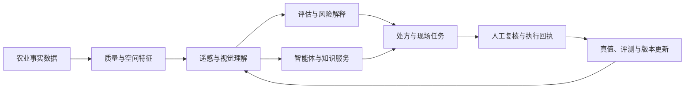
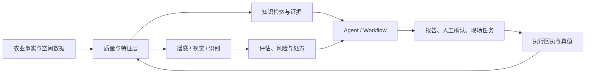

# 技术资产与研发路线 V2.0

公开整理版 · 2026-10-16

---

## 负责人汇报：过去、现在与下一步

## 1. 结论先行

过去一段时间形成的核心资产，不是某一个孤立模型，而是一条从农业事实数据、空间观测、多模态理解、专业知识到农事执行的技术链。它已经具备产品承载、模型调用、报告生成、任务协同和研究转化的基本条件，但各条线成熟度不同，最需要补的不是更多概念，而是统一的真值、版本、评测和验收。

当前最接近产品价值的方向有三类：遥感质量与地块洞察、农资与测土报告识别、农业智能体与知识服务。地块评估和无人机作业协同已经有业务闭环雏形，需要用真实输入和现场回执完成联调。FieldBCQ 和 Wheat-KGCA 是明确的研究候选，下一步要先完成许可、数据、权重和独立验证，再决定是否进入试点。

## 2. 技术资产分层

| 层次 | 资产 | 当前判断 | 关键动作 |
| --- | --- | --- | --- |
| 产品承载 | 生产数据、空间数据、试验与物联网上下文 | 工程基础 | 建立数据产品目录和质量评分 |
| 感知与理解 | 遥感质量、地块洞察、农资/报告识别 | 工程候选到试点 | 冻结质量协议和字段级真值 |
| 决策与协同 | 地块评估、风险解释、处方和无人机任务 | 原型联调 | 做输入快照、专家复核和现场回执 |
| 交互与知识 | Agent、工作流、RAG、证据门禁 | 工程骨架 | 建固定问集、工具成功率和失败恢复评测 |
| 研究转化 | FieldBCQ、Wheat-KGCA | 研究成果 | 许可核验、复现、区域盲测、试点验收 |
| 资产治理 | 专利、软著、评测制度 | 台账与核验 | 建立权利要求到产品验收的对应链 |

## 3. 过去形成的关键成果

1. 形成了覆盖农业生产、环境、空间和试验上下文的产品承载能力，模型不再是脱离业务输入的单点接口。
2. 遥感方向形成了从观测质量判断、时序曲线、恢复候选到空间洞察的完整思路，明确了何时应该拒绝结果。
3. 多模态识别方向形成农药、肥料、助剂和测土报告四条处理链，稳定响应、字段校验和人工复核边界已经清晰。
4. 智能体方向形成统一执行、显式工作流、专业工具、知识检索和证据门禁的组合，而不是只做开放式对话。
5. 地块评估、处方、飞手任务和回执已经可以组织成产品闭环，下一步是把软件状态与真实执行状态分开验收。
6. 两项外部研究成果提供了地块边界分割和知识约束视觉识别的候选技术来源，具备继续验证和服务化的价值。
7. 7 项专利事项和 4 项软著已经形成资产台账，但联合权属、许可和产品实施仍需持续核对。

## 4. 现状判断

当前最重要的事实是“工程骨架已经形成，证据等级还没有统一”。部分能力可以在软件层面运行，部分研究结果只有历史报告或论文指标，现场效果和线上稳定性还没有形成同一张验收表。因而管理汇报需要同时写清楚能力、阶段、证据和缺口，避免把研究成果直接写成产品精度。

## 5. 未来路线

### 第一阶段：统一资产和基线

冻结技术资产清单、数据授权、输入输出契约、样本划分、权重摘要、指标口径和证据等级；把每项能力的“可用条件”和“拒绝条件”写进验收表。

### 第二阶段：把候选能力接入产品试点

优先推进识别、遥感质量、地块评估和 Agent 的固定场景。每个场景都要有代表性输入、异常样例、人工复核、超时/失败处理和结果版本回传。

### 第三阶段：用区域和现场真值验证

对 FieldBCQ、Wheat-KGCA、遥感时序和地块评估做区域留出、设备留出和专家复核；对处方和无人机协同增加面积/剂量守恒、定位偏差和执行回执。

### 第四阶段：形成可规模化的模型产品

建立模型注册、质量监控、漂移报警、回滚和效果回收机制；把专利、软著、研究论文、产品版本和客户/田间验收放入同一条转化链。

## 6. 本轮需要管理决策的事项

- 明确每条技术线的负责人、验收人和停止条件。
- 批准真实数据、专家标注、区域盲测和现场试点所需资源。
- 对外部研究成果先完成许可和数据权利核对，再决定商业化集成范围。
- 对联合权属专利明确实施、收益、维护和产品使用边界。

---

## 技术能力全景

本页用能力视角总结过往研发投入，不列本地目录、代码位置、分支或提交信息。现有研发资产可以归纳为十条相互连接的技术线；它们共同支撑产品、研究和现场协同。

## 1. 十条技术线

| 技术线 | 解决的问题 | 当前阶段 | 下一步 |
| --- | --- | --- | --- |
| 农业生产数据与空间底座 | 让地块、环境、农事、试验和主数据有统一上下文 | 工程基础 | 数据目录、质量评分、授权和版本快照 |
| 遥感质量与地块洞察 | 把多时相影像转成可信的长势和空间依据 | 工程候选到试点 | 真实锚点、跨区域指标和质量协议 |
| 地块评估与风险解释 | 组织土壤、气候、地形、植被和经营证据 | 原型联调 | 输入快照、评分版本和专家一致性 |
| 农业智能体与知识服务 | 让农业问答、分析和动作调用有证据可追溯 | 工程骨架 | 固定问集、工具评测和失败恢复 |
| 农资与测土报告识别 | 降低录入成本，形成可校验的结构化字段 | 服务化候选 | 字段真值、正确留空和批测结果 |
| 无人机与精准作业协同 | 把处方和模型结果连接到现场任务 | 工程协同 | 设备适配、执行回执和剂量验收 |
| FieldBCQ 地块边界研究 | 自动提取边界并降低人工修边成本 | 研究成果 | 许可、区域盲测、拓扑和人工审核 |
| Wheat-KGCA 生育期视觉研究 | 用知识约束提升阶段识别的可解释性 | 研究成果 | 结果包、权重、区域和设备验证 |
| 知识产权与成果转化 | 让专利、软著、研究和产品之间可对应 | 台账与核验 | 权利要求、许可和验收五联表 |
| 评测与研发治理 | 让阶段性结果能够复现、发布和回收效果 | 制度建设 | 统一实验卡、发布门禁和漂移监测 |

## 2. 研发投入的结构

研发投入经历了三个阶段。第一阶段是产品和数据底座建设，解决农业对象、空间对象、环境数据和任务状态的承载问题。第二阶段是专业能力建设，重点落在遥感、识别、智能体、评估和处方协同。第三阶段开始出现可继续转化的研究成果，需要把论文式结果变成可复现、可授权、可验收的产品候选。

这个结构意味着后续工作不能只追求新增模型数量。更有效的增量，是让已有能力拥有统一的数据协议、模型版本、失败边界和真实反馈。

## 3. 能力之间的连接

## 4. 公共版本的边界

公开版不提供源代码索引、部署入口、内部地址、配置值、个人信息、客户地块和模型权重。需要进行研发接续时，应在内部资产系统中补齐版本、授权、数据和运行证据，再把经过审查的结论更新到本公开版。

---

## 技术资产组合与成熟度

## 1. 成熟度定义

| 等级 | 含义 | 可以对外表达 |
| --- | --- | --- |
| P0 课题 | 有问题定义或研究设想 | 拟研究、待验证 |
| P1 工程基础 | 有稳定的业务承载、流程或服务边界 | 已形成工程基础 |
| P2 候选能力 | 有模型/规则/流程和部分历史结果 | 可进入受控试点 |
| P3 产品试点 | 有固定输入、人工复核、版本和验收记录 | 已完成试点验证 |
| P4 规模化产品 | 有生产监控、漂移管理、现场反馈和回滚 | 已产品化并持续运营 |

本版大部分资产处于 P1-P2；FieldBCQ 和 Wheat-KGCA 是研究阶段的 P2 候选，不把外部论文指标改写成 P3/P4。

## 2. 资产台账

| 资产 | 阶段 | 当前成果 | 关键缺口 | 转化优先级 |
| --- | --- | --- | --- | --- |
| 农业生产数据与空间底座 | P1 | 生产、空间、环境、试验和主数据可以被统一业务使用 | 授权、质量、跨区一致性、快照 | 高 |
| 遥感质量与地块洞察 | P2 | 质量分层、恢复候选、时序曲线和空间消费边界 | 真实锚点、跨区指标、业务验收 | 高 |
| 地块评估与风险解释 | P1-P2 | 申请、指标、评分、报告和人工审核闭环设计 | 模型适配、专家一致性、独立真值 | 高 |
| 农业智能体与知识服务 | P1-P2 | Agent、工作流、工具、知识检索和证据门禁组合 | 任务成功率、成本、延迟、恢复 | 高 |
| 农资与测土报告识别 | P2 | 四类识别链、字段校验和复核边界 | 字段真值、拒识、整体批测 | 高 |
| 无人机与精准作业协同 | P1-P2 | 任务、处方、版本、下载和回执链条 | 设备执行、剂量、定位、异常 | 中高 |
| FieldBCQ | P2 | 研究数据划分和消融指标可复述 | 许可、权重、区域盲测、矢量化 | 中高 |
| Wheat-KGCA | P2 | 知识约束、视觉语义融合和消融框架 | 最终成绩、数据、权重、适配 | 中高 |
| 知识产权与成果转化 | P1 | 7 项专利事项和 4 项软著台账 | 权属、许可、权利要求、验收 | 高 |
| 评测与研发治理 | P1 | 证据等级和统一评测原则 | 统一实验卡、发布门禁、漂移 | 高 |

## 3. 资源投入建议

短期资源优先投入遥感质量、识别、Agent 和地块评估，因为这些能力已经有产品承载。研究成果投入以“复现和许可”为前置条件，避免在没有数据权利和可重复结果的情况下直接开发集成。现场闭环投入应同时覆盖农艺、设备和数据，而不是只安排模型开发。

---

## 产品集成与现场闭环

## 1. 四条主工作流

### 工作流 A：遥感到空间洞察

观测进入质量分层，只有质量可解释的结果才进入 NDVI、分区、地块评估和处方。恢复结果必须标明来源和不确定性，清晰观测和估算结果不能混成同一种事实。

### 工作流 B：识别到主数据

农药二维码、肥料、助剂和测土报告经过图像质量判断、VLM/OCR 抽取、字段规则校验和人工复核。结构化结果进入主数据或待确认队列，缺失字段保留为空，不用模型猜测填满。

### 工作流 C：知识到智能体

用户问题先绑定组织、地块、会话和权限，再由智能体选择知识检索、专业工具或明确工作流。结果需要记录证据、工具返回、约束和人工确认状态，才能进入业务报告或下一步动作。

### 工作流 D：处方到现场回执

模型或评估结果先生成可审核的处方版本，再做单位、面积、坐标、设备能力和安全边界检查，最后创建现场任务并接收下载、执行和失败回执。软件显示“完成”不等于设备已经完成作业。

## 2. 概念架构

## 3. 当前集成边界

| 能力 | 产品承载 | 模型状态 | 现场状态 |
| --- | --- | --- | --- |
| 遥感质量与 NDVI | 已有业务消费场景 | 候选质量协议 | 清晰锚点和跨区验收待补 |
| 农资/报告识别 | 已有识别流程 | 服务化候选 | 人工批测待建立 |
| Agent 与知识 | 已有交互和工具形态 | 工程骨架 | 任务成功率和成本待测 |
| 地块评估 | 申请、报告和审核链条 | 原型联调 | 专家一致性和真实输入待测 |
| 处方与无人机 | 任务、版本和回执 | 工程协同 | 设备执行偏差待测 |
| 研究成果 | 尚未完成产品集成 | P2 候选 | 许可和区域盲测前置 |

## 4. 最小可验收产品单元

每个模型能力进入产品时，至少需要：一个冻结输入样例集、一个明确输出契约、一份错误和拒识样例、一条人工复核路径、一个版本标识、一组延迟/错误指标和一项真实业务验收。缺少其中任一项，只能写“候选能力”或“研究成果”。

---

## 遥感质量与地块洞察

## 1. 技术问题

农业遥感的关键不是把每个有云日期都补成一张“看起来完整”的图，而是判断哪些像元来自真实观测、哪些来自恢复估算、哪些应该拒绝。只有先把来源和质量说清楚，NDVI 时序、地块分区、评估和处方才有可靠边界。

## 2. 当前已经形成的能力

- 对多时相观测做清晰、部分可见和拒绝分层。
- 对云影、薄雾、厚云和覆盖不足区分消费策略。
- 保留清晰像元，恢复结果标记来源，不把合成估算当作实测。
- 支持 NDVI 时序、空间统计、地块洞察和处方前置数据。
- 为质量不足的日期设计降级和拒绝路径，避免异常结果静默进入业务。

## 3. 现状与边界

当前属于工程候选到受控试点阶段。质量门槛和处理路线已经明确，但还缺少覆盖不同区域、季节、传感器和天气条件的真实清晰锚点。已有工程测试只能证明流程和接口的某个版本可运行，不能直接替代去云精度、时序偏差或处方效果。

遥感结果至少要分为四种事实：原生清晰观测、质量不足但可视化降级、恢复估算、拒绝。不同事实进入地图、统计、评估和处方时应有不同权限。

## 4. 推荐质量评测

| 层面 | 指标 | 目的 |
| --- | --- | --- |
| 覆盖 | 清晰覆盖率、有效像元率 | 判断是否足以消费 |
| 数值 | 光谱误差、NDVI 误差、偏差 | 判断恢复是否改变趋势 |
| 时序 | 日期留出误差、物候偏差、曲线稳定性 | 判断曲线能否支撑比较 |
| 空间 | 地块内一致性、边界外溢、分区稳定 | 判断结果能否支撑地块决策 |
| 业务 | 统计误差、报告一致性、处方误差 | 判断是否能进入产品 |

## 5. 下一步路线

1. 冻结质量协议和四种结果类型，所有结果返回来源、覆盖和不确定性。
2. 建立跨区域、跨季节、跨设备的真实清晰锚点集，测试恢复和时序模块。
3. 分开评估“地图可视化”“统计分析”“地块评估”“处方生成”四种用途。
4. 将质量拒绝、异常样例和人工复核反馈写回数据治理，形成持续改进闭环。

---

## 地块评估、风险解释与报告

## 1. 业务目标

地块评估把土壤、气候、地形、植被、经营和历史事件放到同一个地块时间快照中，输出可解释的等级、风险和下一步动作。它服务的是农业经营、金融评估和生产管理，核心交付不是一个孤立分数，而是“输入是什么、为什么这样判断、哪些证据不足、谁确认过”的完整报告。

## 2. 当前形成的链路

1. **申请与范围**：明确地块、时间窗、服务场景、用途和授权边界。
2. **输入快照**：锁定地块几何、数据日期、质量状态、缺失字段和来源。
3. **指标计算**：按统一字典计算土壤、气候、地形、植被、经营和暴露指标。
4. **分层评分**：保留维度分数、权重、规则版本和不确定性，不只返回总分。
5. **解释与复核**：把主要驱动因素、风险触发条件、缺失证据和建议动作写入报告。
6. **版本回写**：记录人工同意、修订、退回和后续结果，形成下一轮评估的反馈。

## 3. 现状判断

当前处于原型联调阶段。业务对象、申请、评分、报告和人工复核可以组织成闭环，但还没有形成跨地区、跨年份、跨数据质量的独立真值。现阶段可以评审流程和解释结构，不能把示例分数当成金融审批结论或田间效果。

## 4. 评测设计

| 评测面 | 需要回答的问题 | 建议证据 |
| --- | --- | --- |
| 输入完整性 | 缺少关键指标时是否正确降级 | 缺失组合测试、拒绝比例、人工复核记录 |
| 评分稳定性 | 相邻日期和轻微噪声是否造成异常跳变 | 时间扰动、空间留出、版本对照 |
| 专家一致性 | 专家是否同意风险等级和主要原因 | 双人或多人盲评、分歧归因 |
| 报告事实性 | 结论是否能回到输入和规则 | 事实引用覆盖、数字一致性、追溯抽查 |
| 业务效用 | 报告是否减少判断时间或降低漏评 | 完成时长、修订率、后续结果 |

## 5. 下一步

- 冻结指标字典、权重版本和缺失处理规则。
- 建立覆盖正常、异常、边界和数据不足的地块样例集。
- 让每个结论带输入快照、证据摘要、置信等级和人工状态。
- 将评估结果与处方、任务和执行回执分开验收，再用真实结果评估增益。

---

## 农业智能体与知识服务

## 1. 技术定位

农业智能体承担的是复杂问题的组织和执行：识别用户意图，绑定地块和时间上下文，检索专业知识，调用工具，解释证据，并在需要时把结果交给人工确认。它不是把所有问题交给一个开放式对话模型，而是把高风险步骤拆成可检查的工作流。

## 2. 组合结构

| 组成 | 作用 | 当前阶段 |
| --- | --- | --- |
| 统一执行 | 维护会话、权限、状态和输出格式 | 工程骨架 |
| 显式工作流 | 固定步骤、分支、重试、人工确认和回写 | 工程骨架 |
| 专业工具 | 天气、土壤、遥感、识别、报告和任务接口 | 工具候选 |
| 知识检索 | 返回农业规范、产品资料、试验记录和证据片段 | 工程候选 |
| 证据门禁 | 校验来源、时间、适用范围和不确定性 | 待加强 |

## 3. 关键边界

- 工具返回失败时，智能体应说明失败原因和可替代动作，不编造结果。
- 知识检索只提供候选证据，涉及剂量、风险和合规的结论必须经过规则或人工确认。
- 会话恢复要保留已完成步骤、工具返回、待确认项和版本，不能只保存自然语言摘要。
- 生产日志需要区分模型输出、工具事实、人工修改和最终发布结果。

## 4. 建议评测集

建立固定问集，覆盖事实查询、跨源分析、工具调用、拒答、权限、缺失数据、长流程恢复和报告生成。每个样例至少记录：任务是否完成、关键事实是否正确、证据是否充分、工具是否成功、延迟和成本、是否需要人工介入。

建议指标包括任务成功率、工具成功率、证据召回率、约束满足率、事实错误率、人工接管率、P95 延迟、单任务成本和失败恢复成功率。指标要按场景分层，不能用一个总平均数掩盖高风险任务的失败。

## 5. 下一步

1. 冻结农业固定问集和工具契约。
2. 为每个高风险工具增加输入校验、输出 schema 和审计字段。
3. 建立知识版本、证据有效期和冲突处理规则。
4. 以小范围试点验证可靠性、成本和人工节省，再扩大工具覆盖。

---

## 农资、助剂与测土报告识别

## 1. 统一原则

识别服务的目标是把图片和报告转成可校验的结构化字段。每个字段都应能回到原文区域或图像证据；缺失字段保留为空；低置信度、冲突值和不可读输入进入人工复核。模型猜出的完整答案不能替代事实。

## 2. 四条输入链

| 输入 | 主要字段 | 关键处理 |
| --- | --- | --- |
| 农药二维码 | 登记信息、名称、规格、适用范围 | 码读取、登记信息比对、过期或冲突提示 |
| 肥料包装 | 品类、养分、规格、厂家、批次 | 图像质量、文字抽取、单位和范围校验 |
| 助剂资料 | 名称、用量、价格、适配作物 | 包装/单据识别、字段归一、人工确认 |
| 测土报告 | pH、有机质、氮磷钾、盐分等指标 | 表格定位、OCR/VLM 抽取、单位和行列校验 |

## 3. 当前阶段

四类流程已经具备稳定响应、条件 OCR/VLM、字段规则和人工复核边界，属于服务化候选。现阶段的主要风险不是单张图片能否识别，而是批量输入的字段完整率、正确留空、单位一致性、重复记录和成本控制。

## 4. 评测口径

- **字段级准确率**：名称、规格、含量、单位、日期等分别统计，不以整张图片一个分数代替。
- **正确留空率**：输入不可读或字段不存在时，系统是否保持空值并说明原因。
- **拒识质量**：不可安全识别的样本是否及时进入人工队列。
- **批量稳定性**：不同设备、光照、版式和文件大小下的成功率与延迟。
- **业务收益**：人工录入时间、复核改动率、主数据重复率和异常拦截率。

## 5. 下一步

先建设字段级真值和错误类型目录，再冻结单位归一、冲突优先级和拒识规则；随后按单张、批量和异步三种模式评估成本与延迟，最后接入主数据和报告服务。涉及安全、合规或施用建议的字段，必须保留人工确认状态。

---

## 研究成果与转化边界

## 1. 统一判断

本页保留两项公开研究成果，目的是说明技术价值、历史结果和继续验证的路径。论文或上游仓库中的指标属于指定数据、指定版本和指定实验设置下的报告结果，不等于当前产品精度，也不等于已经完成现场验收。

## 2. FieldBCQ：地块边界实例分割

公开资料给出的数据规模为 15,000 张图像、403,199 个实例，训练集 12,000 张/353,352 个实例，验证集 1,000 张/28,657 个实例，测试集 2,000 张/21,190 个实例；测试集中包含 83 张空标注图像。数据覆盖 26 个国家和 8 种传感器分辨率。

历史消融结果如下，数值保留报告中的均值与标准差口径：

| 方法 | Precision | Recall | F1 | mAP50 | mAP75 | mAP50-95 |
| --- | ---: | ---: | ---: | ---: | ---: | ---: |
| Baseline | 0.663±0.012 | 0.600±0.001 | 0.630±0.005 | 0.611±0.007 | 0.400±0.008 | 0.390±0.006 |
| PCSC | 0.672±0.010 | 0.606±0.003 | 0.637±0.004 | 0.622±0.006 | 0.411±0.006 | 0.400±0.005 |
| BAPS+PCSC | 0.673±0.009 | 0.614±0.002 | 0.642±0.004 | 0.628±0.005 | 0.415±0.006 | 0.405±0.005 |
| FieldBCQ | 0.694±0.008 | 0.615±0.003 | 0.652±0.004 | 0.640±0.005 | 0.434±0.005 | 0.420±0.004 |

转化价值在于降低地块建档和人工修边成本。进入产品前必须核对数据和权重许可，做目标区域盲测，增加边界拓扑修正、矢量化、人工审核和版本回写。

## 3. Wheat-KGCA：知识约束视觉识别

公开框架围绕八类生育阶段，组合专家规则、结构化视觉语言模型证据、ConvNeXtV2/RCA 视觉主干、语义-视觉融合、知识约束损失和 CAM 可解释性。它的技术价值是利用阶段相邻关系和专家知识，减少相似阶段混淆，并让结果能解释到视觉证据和规则。

当前未获得可独立核验的最终成绩、完整数据、训练权重和产品适配材料，因此只把它列为研究候选。下一步应先核对许可和结果包，再做固定推理、设备/区域/品种留出验证，最后接入人工复核工具。

## 4. 转化闸门

两项成果都按“许可核验 → 数据/权重完整 → 独立复现 → 目标区域盲测 → 业务试点 → 验收回写”推进。任何一关未完成，都只能保留在研究阶段，不应直接写成生产模型或线上指标。

---

## 知识产权与成果转化

## 1. 公开台账的用法

本页对应 `data/intellectual-property.json` 的公开字段，记录专利事项和软件著作权的登记状态、权属记录、技术方向和转化边界。它是研发治理台账，不替代证书、法律意见、联合申请协议或许可合同。

## 2. 状态摘要

台账包含 7 项专利事项和 4 项软件著作权。专利状态分别覆盖授权证书、授予专利权通知书和初步审查合格；软著均记录为登记证书。联合权属、实施约定、权利要求范围和转让/许可状态仍需以正式文件复核。

## 3. 技术映射

| 方向 | 可关联能力 | 转化前要补的证据 |
| --- | --- | --- |
| 遥感云影处理与 NDVI 修复 | 遥感质量、时序和空间洞察 | 权利要求映射、算法版本、清晰锚点和业务验收 |
| 无人机苗情与样方矢量化 | 现场调查、真值采集和作业协同 | 联合实施约定、定位误差、区域盲测 |
| 地块边界实例分割 | 地块建档、拓扑修正和版本库 | 与研究成果的具体对应、权重许可、人工修订成本 |
| 专家知识与阶段监测 | 视觉识别、智能体和解释报告 | 权利要求范围、结果包、样本许可和独立验证 |
| 平台与评估软件 | 农业生产、移动端、评估和试验服务 | 版本范围、实施记录、验收和持续维护责任 |

## 4. 五联表建议

每项权利建立“权利要求—技术能力—产品版本—验收证据—许可/权属”五联表。季度复核法律状态，版本发布前核对第三方数据和权重来源，合作交付前核对使用范围、改进成果和现场责任。

---

## 开放课题与未来技术路线

## 1. 状态口径

本页保留本技术负责人负责的 16 项开放课题。05、06 按用户确认标为未启动，其余课题标为已开始规划研究；“已开始规划”只表示方向和准备工作进入计划，不代表实验完成、服务上线或现场验收。

## 2. 课题总览

| 编号 | 课题方向 | 状态 | 计划批次 | 首个交付物 |
| --- | --- | --- | --- | --- |
| 02 | 多年遥感时序生产力分区与土壤地力底图 | 已开始规划 | 第二批 | 质量分层和跨年基线 |
| 03 | 降水雷达降尺度与预报融合 | 已开始规划 | 第三批 | 雷达/站点配准基线 |
| 04 | 多源时空农业生产风险评估 | 已开始规划 | 第二批 | 风险事件与校准集 |
| 05 | 农业物联网采集网关 | 未启动 | 待单独立项 | 协议和硬件评审 |
| 06 | 变量作业控制系统 | 未启动 | 待单独立项 | 设备能力与安全边界 |
| 07 | 无人机精准施药默认参数库 | 已开始规划 | 第一批 | 参数来源和适用约束 |
| 08 | 农田地块智能分割与数据库 | 已开始规划 | 第一批 | 权重核验和区域盲测集 |
| 09 | 土地综合评价与种植风险评估 | 已开始规划 | 第一批 | 指标字典和地块快照 |
| 12 | 地块分区评价与变量播种施肥 | 已开始规划 | 第二批 | 稳定分区与对照方案 |
| 13 | 变量处方与农机作业图 | 已开始规划 | 第一批 | 单位/坐标校验器 |
| 14 | 杂草识别与精准施药处方 | 已开始规划 | 第二批 | 多杂草定位真值集 |
| 15 | 收获实时测产与产量地图 | 已开始规划 | 第三批 | 传感同步和标定记录 |
| 16 | 遥感影像修复与 NDVI 时序拟合 | 已开始规划 | 第一批 | 清晰锚点和日期留出基线 |
| 17 | 病虫草害识别智能体 | 已开始规划 | 第二批 | 固定问图集与拒识集 |
| 18 | 生育期识别智能体 | 已开始规划 | 第一批 | 阶段标准与连续观测集 |
| 19 | 病斑严重度识别与分级智能体 | 已开始规划 | 第二批 | 病斑掩膜和分级真值 |

## 3. 技术路线与评测

| 课题 | 建议路线 | 关键评测 |
| --- | --- | --- |
| 02 | 时空特征统一 → 异常控制 → 稳定分区 → 土壤采样校准 | 跨年稳定性、空间留出误差、与实测关系 |
| 03 | 雷达与站点配准 → 插值基线 → 降尺度融合 → 事件验证 | MAE/RMSE、阈值命中/虚警、提前量 |
| 04 | 灾种与暴露定义 → 历史事件标注 → 风险评分 → 动态更新 | 校准、漏报/虚警、提前量、地区留出 |
| 05 | 协议冻结 → 网关采集 → 离线缓存 → 平台联调 | 完整率、延迟、离线恢复、长期稳定 |
| 06 | 设备能力 → 处方解析 → 闭环控制 → 台架/现场执行 | 施用偏差、定位同步、故障保护 |
| 07 | 药械和阶段标准 → 参数分级 → 适用约束 → 专家复核 | 来源覆盖、默认值错误、田间偏差 |
| 08 | 影像/权重核验 → 实例分割 → 拓扑修正 → 人工版本库 | Mask AP、边界面积误差、修边耗时 |
| 09 | 规则审查 → 地块快照 → 多源证据 → 风险报告 | 缺失处理、评分稳定、专家一致性 |
| 12 | 稳定环境特征 → 可解释分区 → 响应建模 → 试验反馈 | 分区稳定、剂量约束、对照效果 |
| 13 | 标准处方 → 单位坐标校验 → 设备适配 → 下发回执 | 格式兼容、剂量守恒、失败恢复 |
| 14 | 影像 → 杂草检测/覆盖 → 地理聚合 → 审核分区 | 分类别精召、定位误差、漏喷/误喷面积 |
| 15 | 传感同步 → 异常校正 → 产量图 → 统计反馈 | 标定误差、称重守恒、空间偏移 |
| 16 | 观测/估算分开 → 曲线基线 → 候选修复 → 物候提取 | 日期留出、云污染分层、物候偏差 |
| 17 | 知识分层 → 图像质量 → 模型候选 → 问询解释 | Macro-F1、未知类拒绝、有据性 |
| 18 | 阶段标准 → 视觉/语义融合 → 连续观测校正 → 复核工具 | Macro-F1、相邻阶段错误、跨区泛化 |
| 19 | 病斑掩膜 → 有效面积 → 分级标准 → 不确定性解释 | IoU、严重度 MAE、等级一致性 |

## 4. 分阶段排期

| 时间窗 | 重点 | 门禁 |
| --- | --- | --- |
| 0–30 天 | 资产、数据、权属、固定基线和负责人 | 有授权、有版本、有可复现基线 |
| 31–90 天 | 已有能力服务化、小范围产品试点 | 输入冻结、对照评测、可回滚 |
| 3–6 个月 | 跨季节/区域、空间作业和现场设备联调 | 专家真值、空间/时间留出、回执验收 |
| 6–12 个月 | 数据产品、设备闭环和持续监控 | 真实投入/产出结果、SLO 和漂移门禁 |

课题之间共享质量、版本、权限和评测底座，但每项课题仍需独立验收。依赖关系可以并行准备，不能用基础设施完成替代单课题结果。

---

## 数据、结果与统一评测口径

## 1. 数据资产分层

| 层级 | 内容 | 发布要求 |
| --- | --- | --- |
| 事实数据 | 地块、环境、农事、试验、设备和主数据 | 授权、时间、空间和质量标签 |
| 观测数据 | 遥感影像、无人机影像、报告图片和传感数据 | 设备、采集条件、原始/估算来源 |
| 标注真值 | 边界、识别字段、风险等级、处方和现场回执 | 标注规范、复核记录、版本 |
| 研究结果 | 指标、消融、错误样例和复现实验记录 | 数据划分、权重、环境和许可 |
| 产品反馈 | 人工修订、拒识、任务执行和业务结果 | 责任人、时间、状态和闭环关联 |

公开版只分享可说明技术方向和证据边界的内容，不发布内部数据原件、原始样本或配置值。缺失内容在台账中明确写成待核验，不用推测补齐。

## 2. 已公开的研究指标

FieldBCQ 的数据规模、划分和历史消融指标见 [研究成果](09-research-results.md) 以及 `data/fieldbcq-dataset-split.csv`、`data/fieldbcq-metrics.csv`。这些指标属于上游研究报告口径，尚未经过本团队目标区域独立复现。

Wheat-KGCA 已公开技术路线和八类阶段框架，但最终成绩、完整数据和权重尚待核对，因此不在本版伪造精度。

## 3. 统一实验卡

每次实验至少记录：目标任务、输入快照、数据许可、训练/推理版本、数据划分、基线、指标定义、误差分层、失败样例、资源消耗、人工复核和结论边界。实验卡要能由另一位成员独立复跑，并能说明哪些结果只适用于研究数据。

## 4. 各能力线的最小指标

- 遥感：覆盖率、光谱/NDVI 误差、日期留出、物候偏差、空间稳定性和拒绝率。
- 识别：字段准确率、正确留空率、拒识率、批处理成功率、延迟和人工改动率。
- 智能体：任务成功率、工具成功率、证据召回、事实错误、P95、成本和恢复率。
- 地块评估：缺失处理、评分稳定、专家一致、报告事实一致和后续结果。
- 作业协同：处方格式、面积/剂量守恒、定位同步、执行回执和异常恢复。
- 研究成果：公开基线、独立复现、区域盲测、拓扑/阶段一致和人工节省。

## 5. 发布门禁

在结果进入产品或公开汇报前，至少完成权属和许可核验、固定输入与版本、独立评测、失败边界、人工复核和回滚方案。报告中的“已形成”“可试点”“已验收”必须分别有对应证据，不能用同一套样例替代。

---

## 视觉图集

本版使用 7 张 PNG 信息图。每张图同时展示技术对象、当前阶段和未来动作，适合管理汇报、评审和章节导读。图中不包含本地路径、仓库位置、分支或代码位置。

| 图 | 技术主题 | 图上表达的当前阶段 | 图上表达的下一步 |
| --- | --- | --- | --- |
| [01-platform-landscape.png](../assets/visuals/01-platform-landscape.png) | 农业智能技术全景 | 工程基础、候选能力、研究成果 | 统一评测与产品承接 |
| [02-remote-sensing.png](../assets/visuals/02-remote-sensing.png) | 遥感质量与地块洞察 | 质量分层和时序路线 | 清晰锚点、跨区评测、质量协议 |
| [03-agent.png](../assets/visuals/03-agent.png) | 智能体与知识服务 | 工程骨架 | 固定问集、工具评测、证据门禁 |
| [04-recognition.png](../assets/visuals/04-recognition.png) | 农资与测土报告识别 | 服务化候选 | 字段真值、正确留空、批测 |
| [05-land-assessment.png](../assets/visuals/05-land-assessment.png) | 地块评估与风险解释 | 原型联调 | 专家一致性和输入快照 |
| [06-research-to-product.png](../assets/visuals/06-research-to-product.png) | 研究成果转化 | 研究阶段 | 许可、复现、区域盲测、试点 |
| [07-ip-and-roadmap.png](../assets/visuals/07-ip-and-roadmap.png) | 知识产权与研发路线 | 台账与核验 | 权利要求、许可和验收映射 |

PNG 由公开仓库内的渲染脚本生成，便于在字体或版式调整后重新产出。视觉图是解释工具，不替代数据表、实验卡和正式法律文件。

---

## 证据登记与缺口

## 1. 公开证据等级

| 等级 | 含义 | 可以支持的表述 |
| --- | --- | --- |
| E0 | 方向或设想 | 拟研究、待验证 |
| E1 | 产品/工程基础存在 | 已形成基础、具备承载条件 |
| E2 | 受控样例或历史结果 | 可进入受控验证，不代表生产效果 |
| E3 | 独立复现和目标区域验证 | 可申请小范围试点 |
| E4 | 产品/现场验收和持续监控 | 可对外说明已验收或持续运营 |

## 2. 本版证据清单

| 资产 | 当前等级 | 公开依据 | 主要缺口 |
| --- | --- | --- | --- |
| 数据与空间底座 | E1 | 技术能力说明和产品流程 | 授权、质量、跨区域一致性 |
| 遥感质量与地块洞察 | E1–E2 | 技术路线、视觉图和课题路线 | 清晰锚点、跨区域指标、业务验收 |
| 地块评估与风险解释 | E1 | 流程与报告设计 | 专家真值、评分稳定、后续结果 |
| 智能体与知识服务 | E1 | 组合结构和建议评测 | 固定问集、工具成功率、成本 |
| 农资与测土报告识别 | E1–E2 | 四类流程和字段规则 | 字段真值、批量稳定、拒识 |
| 作业协同 | E1 | 处方/任务/回执流程 | 设备、剂量、定位、异常恢复 |
| FieldBCQ | E2 | 上游公开研究与历史消融 | 许可、区域盲测、矢量化 |
| Wheat-KGCA | E2 | 上游公开框架 | 最终结果、数据、权重、适配 |
| 知识产权 | E1 | 公开字段台账 | 原件、权属、许可、权利要求 |

## 3. 证据缺口处理

缺口分为数据授权、结果复现、工程稳定、现场真值和法律权属五类。每项缺口要指定责任人、截止时间、验收条件和失败后的降级方案。没有证据时保留“待核验”，不根据标题、接口或单张样例推断成熟度。

## 4. 公开版边界

本仓库只保留可公开分享的概念、汇总指标、来源链接和证据口径。原始证书、完整数据、生产日志、私有配置和内部协作记录不放入公开仓库；需要评审时通过合规渠道提供受控材料。

---

## 公开仓库维护说明

## 1. 更新原则

每次更新都先确认范围、权属和公开性，再更新技术领域、课题状态、指标、来源和视觉图。任何新增结果都要说明数据划分、版本、证据等级和适用边界。

## 2. 日常维护

- 技术能力变化时更新 `data/technology-areas.json` 和相关章节。
- 课题状态变化时同步 `data/topics.json`、`data/topic-plans.json` 和路线图章节。
- 指标新增或修订时更新 CSV、研究章节和证据登记，并保留历史口径说明。
- 专利或软著状态变化时更新公开台账，法律状态以正式文件为准。
- 视觉表达变化时运行 `scripts/render_visuals.py`，检查 7 张 PNG 的文字、比例和可读性。
- 报告变化时重新生成 `deliverables/` 中的 Markdown、Word 和 PDF。

## 3. 发布前检查

运行 `scripts/validate.py`，确认目录完整、内部信息未泄漏、相对链接有效、图像存在、数据条数符合预期、报告已生成。再人工打开 README、报告和全部视觉图，检查中文字体、表格和图片在 GitHub 页面中的显示。

## 4. 版本记录

公开提交信息只描述用户可理解的内容，例如“更新遥感评测口径”或“补充研究转化路线”。不要在公开提交、Issue、标签或发布说明中写本地路径、内部地址、分支名、提交号或私有协作信息。
