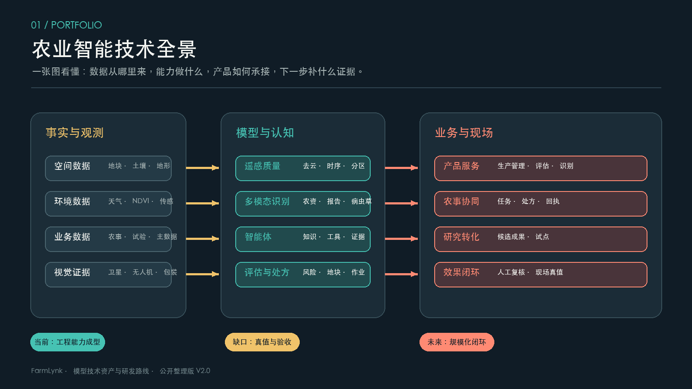

# 负责人汇报：过去、现在与下一步

## 1. 结论先行

过去一段时间形成的核心资产，不是某一个孤立模型，而是一条从农业事实数据、空间观测、多模态理解、专业知识到农事执行的技术链。它已经具备产品承载、模型调用、报告生成、任务协同和研究转化的基本条件，但各条线成熟度不同，最需要补的不是更多概念，而是统一的真值、版本、评测和验收。

当前最接近产品价值的方向有三类：遥感质量与地块洞察、农资与测土报告识别、农业智能体与知识服务。地块评估和无人机作业协同已经有业务闭环雏形，需要用真实输入和现场回执完成联调。FieldBCQ 和 Wheat-KGCA 是明确的研究候选，下一步要先完成许可、数据、权重和独立验证，再决定是否进入试点。

## 2. 技术资产分层

| 层次 | 资产 | 当前判断 | 关键动作 |
| --- | --- | --- | --- |
| 产品承载 | 生产数据、空间数据、试验与物联网上下文 | 工程基础 | 建立数据产品目录和质量评分 |
| 感知与理解 | 遥感质量、地块洞察、农资/报告识别 | 工程候选到试点 | 冻结质量协议和字段级真值 |
| 决策与协同 | 地块评估、风险解释、处方和无人机任务 | 原型联调 | 做输入快照、专家复核和现场回执 |
| 交互与知识 | Agent、工作流、RAG、证据门禁 | 工程骨架 | 建固定问集、工具成功率和失败恢复评测 |
| 研究转化 | FieldBCQ、Wheat-KGCA | 研究成果 | 许可核验、复现、区域盲测、试点验收 |
| 资产治理 | 专利、软著、评测制度 | 台账与核验 | 建立权利要求到产品验收的对应链 |

## 3. 过去形成的关键成果

1. 形成了覆盖农业生产、环境、空间和试验上下文的产品承载能力，模型不再是脱离业务输入的单点接口。
2. 遥感方向形成了从观测质量判断、时序曲线、恢复候选到空间洞察的完整思路，明确了何时应该拒绝结果。
3. 多模态识别方向形成农药、肥料、助剂和测土报告四条处理链，稳定响应、字段校验和人工复核边界已经清晰。
4. 智能体方向形成统一执行、显式工作流、专业工具、知识检索和证据门禁的组合，而不是只做开放式对话。
5. 地块评估、处方、飞手任务和回执已经可以组织成产品闭环，下一步是把软件状态与真实执行状态分开验收。
6. 两项外部研究成果提供了地块边界分割和知识约束视觉识别的候选技术来源，具备继续验证和服务化的价值。
7. 7 项专利事项和 4 项软著已经形成资产台账，但联合权属、许可和产品实施仍需持续核对。

## 4. 现状判断

当前最重要的事实是“工程骨架已经形成，证据等级还没有统一”。部分能力可以在软件层面运行，部分研究结果只有历史报告或论文指标，现场效果和线上稳定性还没有形成同一张验收表。因而管理汇报需要同时写清楚能力、阶段、证据和缺口，避免把研究成果直接写成产品精度。

## 5. 未来路线

### 第一阶段：统一资产和基线

冻结技术资产清单、数据授权、输入输出契约、样本划分、权重摘要、指标口径和证据等级；把每项能力的“可用条件”和“拒绝条件”写进验收表。

### 第二阶段：把候选能力接入产品试点

优先推进识别、遥感质量、地块评估和 Agent 的固定场景。每个场景都要有代表性输入、异常样例、人工复核、超时/失败处理和结果版本回传。

### 第三阶段：用区域和现场真值验证

对 FieldBCQ、Wheat-KGCA、遥感时序和地块评估做区域留出、设备留出和专家复核；对处方和无人机协同增加面积/剂量守恒、定位偏差和执行回执。

### 第四阶段：形成可规模化的模型产品

建立模型注册、质量监控、漂移报警、回滚和效果回收机制；把专利、软著、研究论文、产品版本和客户/田间验收放入同一条转化链。

## 6. 本轮需要管理决策的事项

- 明确每条技术线的负责人、验收人和停止条件。
- 批准真实数据、专家标注、区域盲测和现场试点所需资源。
- 对外部研究成果先完成许可和数据权利核对，再决定商业化集成范围。
- 对联合权属专利明确实施、收益、维护和产品使用边界。
