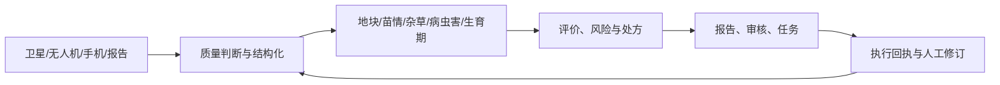

# 技术与产品总览

本页按可交付的技术资产组织内容，不按文件或代码位置组织。每项资产都有明确输入、输出、当前阶段和后续动作。

## 1. 资产分组

| 分组 | 包含资产 | 已有结果 | 当前瓶颈 |
| --- | --- | --- | --- |
| 遥感和空间底座 | Sentinel-2 处理、云影质量、NDVI 修复、地块分割 | 影像质量、时序、地块和处方的空间输入 | 清晰锚点、区域泛化、端到端验收 |
| 无人机识别和作业 | 出苗率/密度、样方矢量化、杂草识别、点喷处方 | 已有专利和参赛资料能力描述 | 正射定位、误差面积、设备回执 |
| 视觉和多模态识别 | 病虫害、病斑、生育期、农资、测土报告 | 四类农资识别流程，病虫草害和生育期方向 | 专家真值、正确留空、批量评测 |
| 评估和决策 | 地块评分、风险解释、变量播种/施肥处方 | 评估与处方产品承载 | 评分稳定、剂量守恒、真实反馈 |
| 智能体和知识 | 知识检索、工具调用、识别和报告 | 工程骨架和场景原型 | 固定问集、证据、工具成功率 |
| 研究转化 | FieldBCQ、Wheat-KGCA | 研究路线和历史结果 | 许可、权重、独立复现、盲测 |

## 2. 产品链路

## 3. 阶段口径

| 阶段 | 本版含义 |
| --- | --- |
| 研究规划 | 已有课题问题和验收指标，尚无完成结果 |
| 能力资产 | 有流程、专利、历史材料或服务骨架，但现场证据未齐 |
| 受控试点 | 有固定输入、版本、人工复核和独立评测 |
| 产品化 | 有现场验收、回执、监控、漂移处理和回滚 |

逐项清单见 [技术资产组合](03-asset-portfolio.md)，法律状态见 [知识产权台账](10-intellectual-property.md)。
