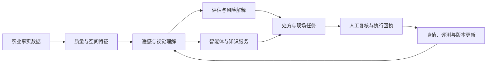

# 技术能力全景

本页用能力视角总结过往研发投入，不列本地目录、代码位置、分支或提交信息。现有研发资产可以归纳为十条相互连接的技术线；它们共同支撑产品、研究和现场协同。

## 1. 十条技术线

| 技术线 | 解决的问题 | 当前阶段 | 下一步 |
| --- | --- | --- | --- |
| 农业生产数据与空间底座 | 让地块、环境、农事、试验和主数据有统一上下文 | 工程基础 | 数据目录、质量评分、授权和版本快照 |
| 遥感质量与地块洞察 | 把多时相影像转成可信的长势和空间依据 | 工程候选到试点 | 真实锚点、跨区域指标和质量协议 |
| 地块评估与风险解释 | 组织土壤、气候、地形、植被和经营证据 | 原型联调 | 输入快照、评分版本和专家一致性 |
| 农业智能体与知识服务 | 让农业问答、分析和动作调用有证据可追溯 | 工程骨架 | 固定问集、工具评测和失败恢复 |
| 农资与测土报告识别 | 降低录入成本，形成可校验的结构化字段 | 服务化候选 | 字段真值、正确留空和批测结果 |
| 无人机与精准作业协同 | 把处方和模型结果连接到现场任务 | 工程协同 | 设备适配、执行回执和剂量验收 |
| FieldBCQ 地块边界研究 | 自动提取边界并降低人工修边成本 | 研究成果 | 许可、区域盲测、拓扑和人工审核 |
| Wheat-KGCA 生育期视觉研究 | 用知识约束提升阶段识别的可解释性 | 研究成果 | 结果包、权重、区域和设备验证 |
| 知识产权与成果转化 | 让专利、软著、研究和产品之间可对应 | 台账与核验 | 权利要求、许可和验收五联表 |
| 评测与研发治理 | 让阶段性结果能够复现、发布和回收效果 | 制度建设 | 统一实验卡、发布门禁和漂移监测 |

## 2. 研发投入的结构

研发投入经历了三个阶段。第一阶段是产品和数据底座建设，解决农业对象、空间对象、环境数据和任务状态的承载问题。第二阶段是专业能力建设，重点落在遥感、识别、智能体、评估和处方协同。第三阶段开始出现可继续转化的研究成果，需要把论文式结果变成可复现、可授权、可验收的产品候选。

这个结构意味着后续工作不能只追求新增模型数量。更有效的增量，是让已有能力拥有统一的数据协议、模型版本、失败边界和真实反馈。

## 3. 能力之间的连接

## 4. 公共版本的边界

公开版不提供源代码索引、部署入口、内部地址、配置值、个人信息、客户地块和模型权重。需要进行研发接续时，应在内部资产系统中补齐版本、授权、数据和运行证据，再把经过审查的结论更新到本公开版。
