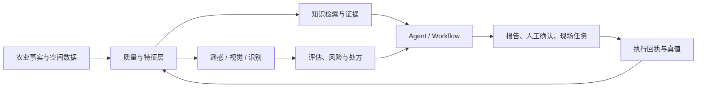

# 产品集成与现场闭环

## 1. 四条主工作流

### 工作流 A：遥感到空间洞察

观测进入质量分层，只有质量可解释的结果才进入 NDVI、分区、地块评估和处方。恢复结果必须标明来源和不确定性，清晰观测和估算结果不能混成同一种事实。

### 工作流 B：识别到主数据

农药二维码、肥料、助剂和测土报告经过图像质量判断、VLM/OCR 抽取、字段规则校验和人工复核。结构化结果进入主数据或待确认队列，缺失字段保留为空，不用模型猜测填满。

### 工作流 C：知识到智能体

用户问题先绑定组织、地块、会话和权限，再由智能体选择知识检索、专业工具或明确工作流。结果需要记录证据、工具返回、约束和人工确认状态，才能进入业务报告或下一步动作。

### 工作流 D：处方到现场回执

模型或评估结果先生成可审核的处方版本，再做单位、面积、坐标、设备能力和安全边界检查，最后创建现场任务并接收下载、执行和失败回执。软件显示“完成”不等于设备已经完成作业。

## 2. 概念架构

## 3. 当前集成边界

| 能力 | 产品承载 | 模型状态 | 现场状态 |
| --- | --- | --- | --- |
| 遥感质量与 NDVI | 已有业务消费场景 | 候选质量协议 | 清晰锚点和跨区验收待补 |
| 农资/报告识别 | 已有识别流程 | 服务化候选 | 人工批测待建立 |
| Agent 与知识 | 已有交互和工具形态 | 工程骨架 | 任务成功率和成本待测 |
| 地块评估 | 申请、报告和审核链条 | 原型联调 | 专家一致性和真实输入待测 |
| 处方与无人机 | 任务、版本和回执 | 工程协同 | 设备执行偏差待测 |
| 研究成果 | 尚未完成产品集成 | P2 候选 | 许可和区域盲测前置 |

## 4. 最小可验收产品单元

每个模型能力进入产品时，至少需要：一个冻结输入样例集、一个明确输出契约、一份错误和拒识样例、一条人工复核路径、一个版本标识、一组延迟/错误指标和一项真实业务验收。缺少其中任一项，只能写“候选能力”或“研究成果”。
