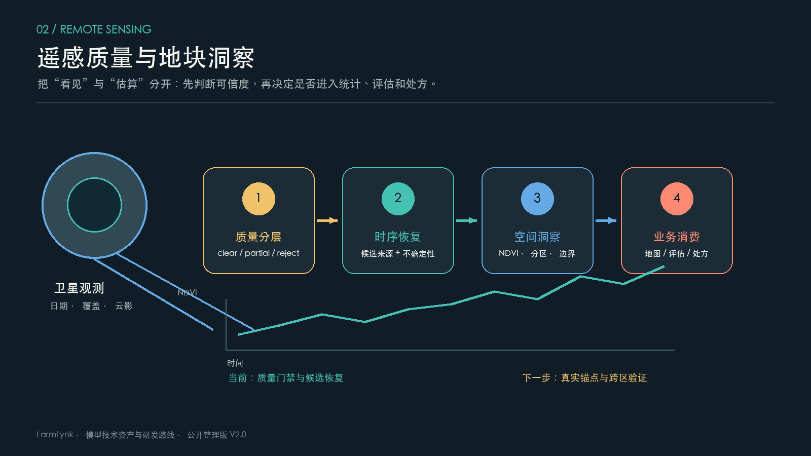

# 遥感质量与地块洞察

## 1. 技术问题

农业遥感的关键不是把每个有云日期都补成一张“看起来完整”的图，而是判断哪些像元来自真实观测、哪些来自恢复估算、哪些应该拒绝。只有先把来源和质量说清楚，NDVI 时序、地块分区、评估和处方才有可靠边界。

## 2. 当前已经形成的能力

- 对多时相观测做清晰、部分可见和拒绝分层。
- 对云影、薄雾、厚云和覆盖不足区分消费策略。
- 保留清晰像元，恢复结果标记来源，不把合成估算当作实测。
- 支持 NDVI 时序、空间统计、地块洞察和处方前置数据。
- 为质量不足的日期设计降级和拒绝路径，避免异常结果静默进入业务。

## 3. 现状与边界

当前属于工程候选到受控试点阶段。质量门槛和处理路线已经明确，但还缺少覆盖不同区域、季节、传感器和天气条件的真实清晰锚点。已有工程测试只能证明流程和接口的某个版本可运行，不能直接替代去云精度、时序偏差或处方效果。

遥感结果至少要分为四种事实：原生清晰观测、质量不足但可视化降级、恢复估算、拒绝。不同事实进入地图、统计、评估和处方时应有不同权限。

## 4. 推荐质量评测

| 层面 | 指标 | 目的 |
| --- | --- | --- |
| 覆盖 | 清晰覆盖率、有效像元率 | 判断是否足以消费 |
| 数值 | 光谱误差、NDVI 误差、偏差 | 判断恢复是否改变趋势 |
| 时序 | 日期留出误差、物候偏差、曲线稳定性 | 判断曲线能否支撑比较 |
| 空间 | 地块内一致性、边界外溢、分区稳定 | 判断结果能否支撑地块决策 |
| 业务 | 统计误差、报告一致性、处方误差 | 判断是否能进入产品 |

## 5. 下一步路线

1. 冻结质量协议和四种结果类型，所有结果返回来源、覆盖和不确定性。
2. 建立跨区域、跨季节、跨设备的真实清晰锚点集，测试恢复和时序模块。
3. 分开评估“地图可视化”“统计分析”“地块评估”“处方生成”四种用途。
4. 将质量拒绝、异常样例和人工复核反馈写回数据治理，形成持续改进闭环。
