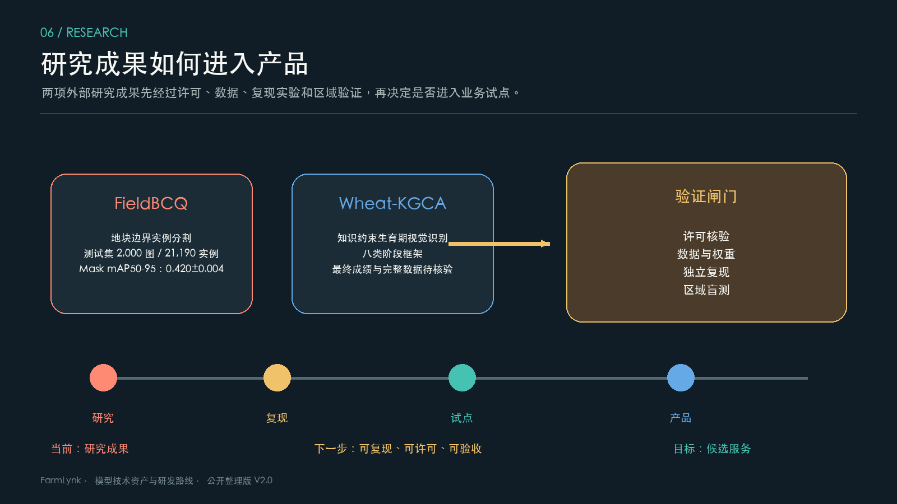

# 研究成果与转化边界

## 1. 统一判断

本页保留两项公开研究成果，目的是说明技术价值、历史结果和继续验证的路径。论文或上游仓库中的指标属于指定数据、指定版本和指定实验设置下的报告结果，不等于当前产品精度，也不等于已经完成现场验收。

## 2. FieldBCQ：地块边界实例分割

公开资料给出的数据规模为 15,000 张图像、403,199 个实例，训练集 12,000 张/353,352 个实例，验证集 1,000 张/28,657 个实例，测试集 2,000 张/21,190 个实例；测试集中包含 83 张空标注图像。数据覆盖 26 个国家和 8 种传感器分辨率。

历史消融结果如下，数值保留报告中的均值与标准差口径：

| 方法 | Precision | Recall | F1 | mAP50 | mAP75 | mAP50-95 |
| --- | ---: | ---: | ---: | ---: | ---: | ---: |
| Baseline | 0.663±0.012 | 0.600±0.001 | 0.630±0.005 | 0.611±0.007 | 0.400±0.008 | 0.390±0.006 |
| PCSC | 0.672±0.010 | 0.606±0.003 | 0.637±0.004 | 0.622±0.006 | 0.411±0.006 | 0.400±0.005 |
| BAPS+PCSC | 0.673±0.009 | 0.614±0.002 | 0.642±0.004 | 0.628±0.005 | 0.415±0.006 | 0.405±0.005 |
| FieldBCQ | 0.694±0.008 | 0.615±0.003 | 0.652±0.004 | 0.640±0.005 | 0.434±0.005 | 0.420±0.004 |

转化价值在于降低地块建档和人工修边成本。进入产品前必须核对数据和权重许可，做目标区域盲测，增加边界拓扑修正、矢量化、人工审核和版本回写。

## 3. Wheat-KGCA：知识约束视觉识别

公开框架围绕八类生育阶段，组合专家规则、结构化视觉语言模型证据、ConvNeXtV2/RCA 视觉主干、语义-视觉融合、知识约束损失和 CAM 可解释性。它的技术价值是利用阶段相邻关系和专家知识，减少相似阶段混淆，并让结果能解释到视觉证据和规则。

当前未获得可独立核验的最终成绩、完整数据、训练权重和产品适配材料，因此只把它列为研究候选。下一步应先核对许可和结果包，再做固定推理、设备/区域/品种留出验证，最后接入人工复核工具。

## 4. 转化闸门

两项成果都按“许可核验 → 数据/权重完整 → 独立复现 → 目标区域盲测 → 业务试点 → 验收回写”推进。任何一关未完成，都只能保留在研究阶段，不应直接写成生产模型或线上指标。
