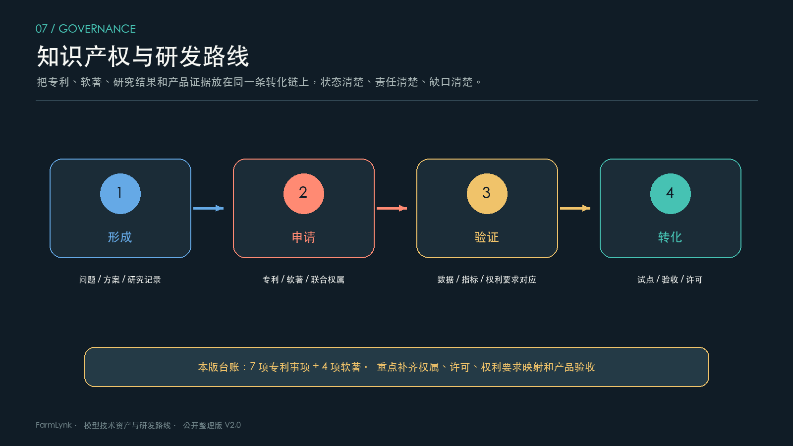

# 知识产权与成果转化

## 1. 公开台账的用法

本页对应 `data/intellectual-property.json` 的公开字段，记录专利事项和软件著作权的登记状态、权属记录、技术方向和转化边界。它是研发治理台账，不替代证书、法律意见、联合申请协议或许可合同。

## 2. 状态摘要

台账包含 7 项专利事项和 4 项软件著作权。专利状态分别覆盖授权证书、授予专利权通知书和初步审查合格；软著均记录为登记证书。联合权属、实施约定、权利要求范围和转让/许可状态仍需以正式文件复核。

## 3. 技术映射

| 方向 | 可关联能力 | 转化前要补的证据 |
| --- | --- | --- |
| 遥感云影处理与 NDVI 修复 | 遥感质量、时序和空间洞察 | 权利要求映射、算法版本、清晰锚点和业务验收 |
| 无人机苗情与样方矢量化 | 现场调查、真值采集和作业协同 | 联合实施约定、定位误差、区域盲测 |
| 地块边界实例分割 | 地块建档、拓扑修正和版本库 | 与研究成果的具体对应、权重许可、人工修订成本 |
| 专家知识与阶段监测 | 视觉识别、智能体和解释报告 | 权利要求范围、结果包、样本许可和独立验证 |
| 平台与评估软件 | 农业生产、移动端、评估和试验服务 | 版本范围、实施记录、验收和持续维护责任 |

## 4. 五联表建议

每项权利建立“权利要求—技术能力—产品版本—验收证据—许可/权属”五联表。季度复核法律状态，版本发布前核对第三方数据和权重来源，合作交付前核对使用范围、改进成果和现场责任。
